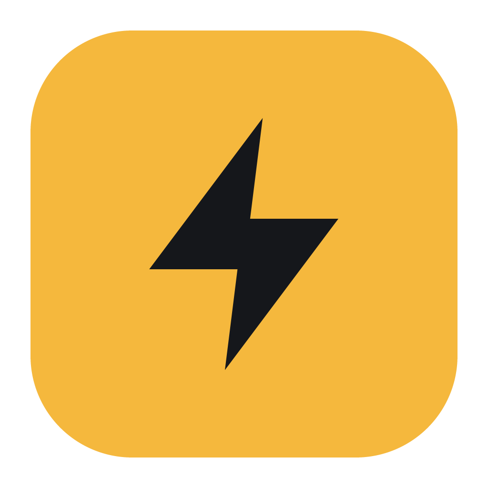
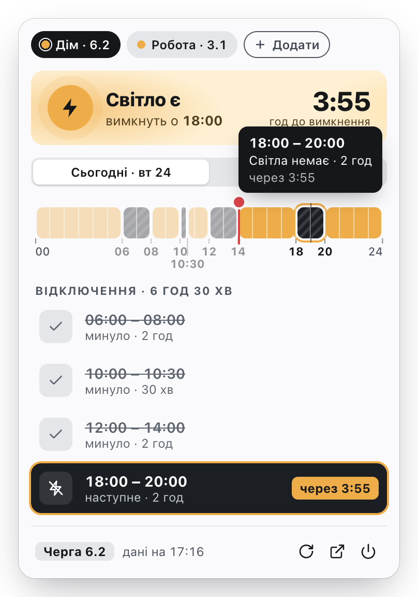
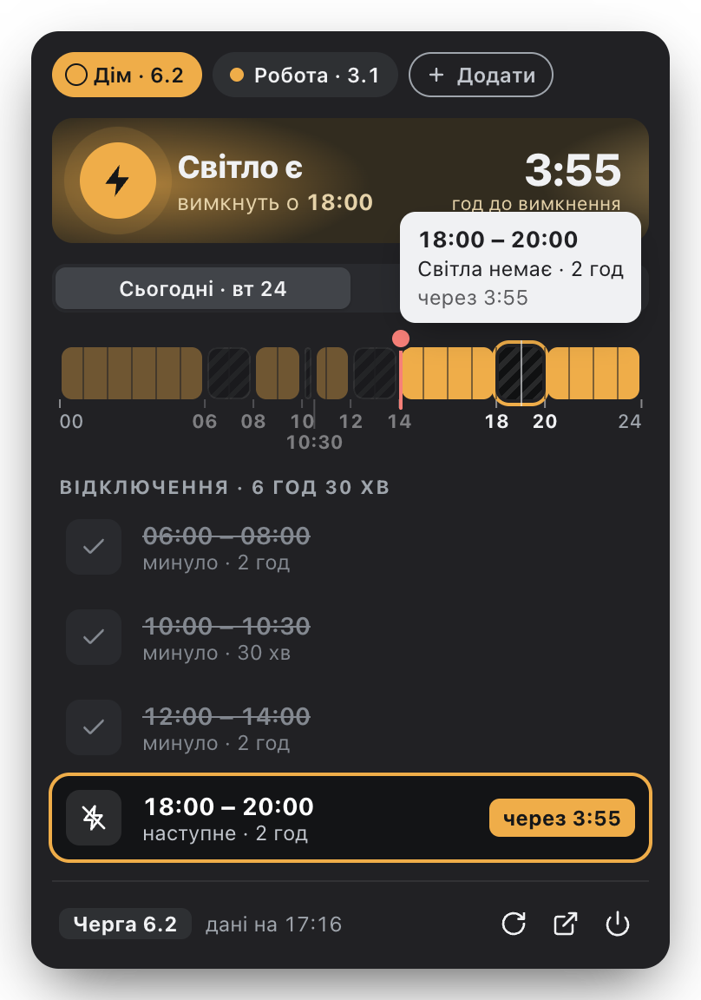

<p align="center">
  
</p>

<h1 align="center">Svitlo</h1>

<p align="center">
  Графік відключень світла Вінницяобленерго — у меню-барі macOS і в треї Windows.<br>
  Скільки ще буде світло, коли вимкнуть, що на завтра.
</p>

<p align="center">
  <a href="https://github.com/vladyslav-deda/svitlo-widget/releases/latest"><b>⬇ Завантажити</b></a>
</p>

<p align="center">
  
  
</p>

## Що вміє

- **Стан у меню-барі / треї.** На Mac поруч з іконкою — «до 18:00»; на Windows — колір іконки і підказка при наведенні.
- **Лінія доби.** Відключення на 24-годинній шкалі, червона позначка «зараз», підписані лише моменти, коли вимикають і вмикають. Наведіть курсор — побачите проміжок, тривалість і скільки до нього; стрілки ← → рухають по пів години.
- **Сьогодні й завтра.** Список відключень з відліком до наступного.
- **Кілька черг.** Дім, робота, батьки — перемикаються вгорі вікна.
- **Сповіщення:**
  - за 15 хвилин до відключення;
  - коли з'явився графік на завтра;
  - коли графік на сьогодні чи завтра змінився: що додали, що скасували.
- **Світла й темна тема** за системою, автозапуск при вході.
- **Автооновлення на Windows.** Нові версії ставляться самі.

## Встановлення

### Windows
1. Завантажте `Svitlo-Setup-<версія>.exe` з [останнього релізу](https://github.com/vladyslav-deda/svitlo-widget/releases/latest) і запустіть.
2. Інсталятор не підписаний, тому SmartScreen попередить: **«Докладніше» → «Все одно запустити»**.
3. Іконка з'явиться в треї біля годинника. Якщо Windows сховала її під стрілку `^`, перетягніть іконку на панель задач.

Далі застосунок оновлюється сам: завантажує нову версію у фоні та встановлює її при наступному запуску або коли ви натиснете сповіщення «Svitlo … готовий».

### macOS (Apple Silicon)
1. Завантажте `Svitlo-<версія>-mac-arm64.zip`, розпакуйте й перетягніть `Svitlo.app` у «Програми».
2. Застосунок не підписаний сертифікатом Apple. Щоб macOS дозволила його запустити, виконайте один раз у Терміналі:
   ```sh
   xattr -cr /Applications/Svitlo.app
   ```
3. Запустіть Svitlo з «Програм».

На Mac автооновлення немає: macOS не дозволяє його для застосунків без платного підпису Apple. Нову версію ставте так само вручну.

### iPhone (віджет, бета)
Працює через безкоштовний застосунок [Scriptable](https://apps.apple.com/app/scriptable/id1405459188).
1. Встановіть Scriptable з App Store і відкрийте його.
2. Натисніть **+**, вставте вміст [`ios/Svitlo.js`](https://raw.githubusercontent.com/vladyslav-deda/svitlo-widget/ios-stable/ios/Svitlo.js) і назвіть скрипт `Svitlo`.
3. Запустіть скрипт (▶︎) і оберіть свою чергу.
4. На домашньому екрані затисніть порожнє місце → **+** → Scriptable → малий віджет. Затисніть віджет → «Змінити віджет» → Script: **Svitlo**.

Скрипт — лише завантажувач: сам віджет він бере з гілки `ios-stable` і оновлює кожні кілька годин, тож перевстановлювати нічого не треба.
Є всі розміри (малий, середній, великий) і віджети для екрана блокування. Вигляд обирається в меню скрипта → «Вигляд віджетів»:
малий — відлік, кільце-таймер, кільце доби, плитка стану; середній — лінія доби, сьогодні й завтра, що далі; великий — як вікно на Mac, дві доби.

Поле **Parameter** окремого віджета приймає чергу і/або вигляд у будь-якому порядку: «Батьки», «3.1», «таймер», «Батьки, таймер».

### Перший запуск
Відкриється вікно вибору черги. Не знаєте свою чергу? Знайдіть її за адресою на [disconnection.voe.com.ua](https://disconnection.voe.com.ua).

## Користування
| | |
|---|---|
| Клік по іконці | відкрити / закрити графік (або Esc) |
| Правий клік | оновити дані, автозапуск, сповіщення про зміни, оновлення застосунку, вихід |
| Наведення на лінію доби | деталі проміжку; рядок у списку підсвічується |
| ← → на лінії | крок пів години |

## Звідки дані
Офіційний сайт VOE закритий від програм (Cloudflare), тому графік береться з публічного дзеркала спільноти
[vn-progr/gpv-voe-vinnytsia](https://github.com/vn-progr/gpv-voe-vinnytsia), яке оновлюється кожні кілька хвилин.
Svitlo перевіряє його кожні 5 хвилин.

> [!IMPORTANT]
> Дзеркало неофіційне. Якщо воно не оновлювалось понад 3 години, Svitlo пише «дані застаріли».
> У разі сумнівів звіряйтеся з [офіційним сайтом](https://disconnection.voe.com.ua).

## Розробка
Потрібен Node.js 20+.

```sh
npm install
npm start          # запуск з вихідного коду
npm test           # тести логіки графіка
npm run icons      # перегенерувати іконки
npm run build:mac  # dist/mac-arm64/Svitlo.app
npm run build:win  # dist/Svitlo-Setup-<версія>.exe
```

Після `build:mac` підпишіть збірку ad-hoc, інакше на Apple Silicon вона не запуститься:
`codesign --force --deep -s - dist/mac-arm64/Svitlo.app`.

### Випуск нової версії
1. Збільште `version` у `package.json`, закомітьте й запуште.
2. `npm run release`. Потрібен [GitHub CLI](https://cli.github.com) з `gh auth login`.

Скрипт [`scripts/release.sh`](scripts/release.sh) проганяє тести, публікує інсталятор Windows разом з `latest.yml` (з нього читає автооновлення) і додає до релізу zip для Mac.

### iPhone-віджет
Код — у `ios/src/widget.js`, логіка графіка спільна з десктопом (`src/schedule.js`).
```sh
node scripts/build-ios.js   # зібрати ios/core.js (один файл, який завантажують телефони)
node scripts/ios-sim.js --now 2026-11-24T14:05:00+02:00 --dark --out /tmp/w.html   # симулятор Scriptable
```
Телефони беруть `ios/core.js` з гілки `ios-stable`. Випуск: перевірити, закомітити в `main`, потім `git push origin main:ios-stable`.

### Змінні середовища для налагодження
| Змінна | Що робить |
|---|---|
| `SVITLO_NOW=2026-11-24T14:05:00+02:00` | підставний поточний час |
| `SVITLO_THEME=dark\|light` | примусова тема |
| `SVITLO_USERDATA=<тека>` | окрема тека налаштувань і кешу |
| `SVITLO_SHOT=<файл.png>` | відкрити вікно, зберегти знімок і вийти |
| `SVITLO_HOVER=<хвилина>` | разом з `SVITLO_SHOT`: навести курсор на лінію доби |
| `SVITLO_LOG=1` | друкувати сповіщення в консоль |

### Структура
```
src/schedule.js   чиста логіка: розбір дзеркала, проміжки, стан, порівняння графіків
src/main.js       трей, сповіщення, оновлення, вікно
src/ui/           вікно графіка (HTML/CSS/JS)
test/             тести логіки на реальних даних
```

## Ліцензія
[MIT](LICENSE)
